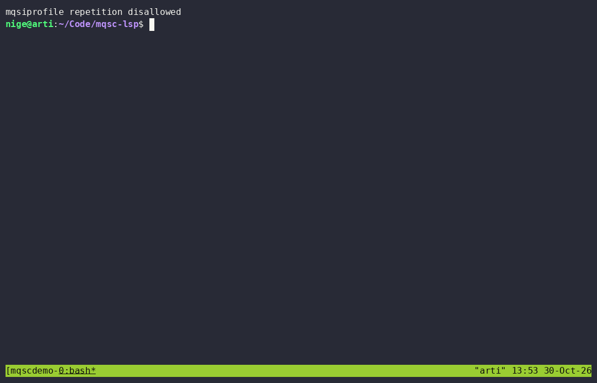

# mqsc-lsp — a language server for IBM MQ MQSC scripts

An LSP server for the IBM MQ Script (MQSC) command language, built on a
purpose-written **tree-sitter grammar** plus a **semantic model extracted
from the IBM MQSC Command Reference** (the 2011 "Script (MQSC) Command
Reference" PDF, converted to markdown and parsed by
[`tools/extract_model.py`](tools/extract_model.py)).

It gives MQSC scripts — the scripts fed to `runmqsc` / `CSQIBP00` /
AMQMQSC, files typically named `*.mqsc` — the editor smarts they never had:
real diagnostics with typo suggestions, hover documentation straight from the
reference, context-aware completion, symbols, folding, and semantic tokens.

## Demo



The ~70-second recording drives real Neovim against the real server
([`tools/demo/`](tools/demo/) holds its throwaway config and a fixture full
of deliberate mistakes): diagnostics appear inline on open — each message
naming the offending token, what was expected, and the concrete fix — a code
action fixes `MAXMSGS` → `MAXMSGL`, completion offers the logical next words
by command slot (the names `DEFINE`d in the script inside `TARGET( … )`, the
object types a verb accepts after `DEFINE `, and an object's parameters after
its name), hover finds the definition of a queue name, rename follows every
reference — including `LIKE`/`TARGET` parameters — quickfix lists the uses,
and even the folds and the dangling `-` at end-of-file come from the server.
Replay the committed cast locally with `asciinema play docs/demo.cast`, and
re-record it with `tools/record_demo.sh` (needs tmux + asciinema; every step
asserts the pane, so a plain run doubles as an end-to-end UI test,
`--record` captures).

## Repository layout

```
grammars/tree-sitter-mqsc/   tree-sitter grammar + external scanner + corpus tests + highlight queries
tools/extract_model.py        extracts the command model from the reference markdown
tools/lsp_smoke_test.py       protocol-level end-to-end test client
tools/workspace_index_smoke.py  end-to-end test for the workspace index (scan + watching)
tools/record_demo.sh          drives/records the feature demo (docs/demo.cast)
model/mqsc-model.json         the extracted model (128 commands, 1336 params, docs, attrs, synonyms)
server/                       Rust LSP server (tower-lsp + tree-sitter), embeds the model
  src/model.rs                model load/lookup, synonym maps, Levenshtein suggestions
  src/analysis.rs             diagnostics, hover, completion, symbols, folding, tokens
  src/workspace.rs            workspace index: open docs + scanned closed files, name-site joins
  src/server.rs               tower-lsp LanguageServer implementation
  examples/                   analysis probes: probe.rs, complete.rs, fold.rs, ws_scan.rs
examples/sample.mqsc          end-to-end validation script
editors/                      editor configuration examples (vscode/ nvim/ helix/)
```

> **Note:** the source reference (`Script (MQSC) Command Reference`, PDF and
> markdown) is IBM copyrighted documentation and is *not* included in this
> repository — see [ATTRIBUTION.md](ATTRIBUTION.md). Supply your own copy when
> (and only when) you want to regenerate the model.

## How it is put together

The **grammar models structure only**: an MQSC command parses as a verb plus a
flat list of words and parenthesized argument groups (`verb`, `word`,
`argument`, `value`, `string`, `wildcard` nodes). Which word is the object
type, which is a keyword parameter, and what value each parameter takes
cannot be expressed in LALR(1) — so the **server resolves roles against the
model** at analysis time. The external scanner owns the tricky lexical bits:
`*`-in-column-1 comments, `+`/`-` end-of-line continuations, and `'...'`
strings with `''` escapes and continuations.

`tools/extract_model.py` mines the dotted-decimal syntax diagrams (plus
railroad-only recovery) embedded in the reference's markdown, producing
`model/mqsc-model.json`: verbs, object types and synonyms (`DEF QL` →
`DEFINE QLOCAL`), per-command parameters with kinds (flag/enum/integer/
string/name), displayable attribute lists, footnotes and parameter
descriptions. The server embeds that JSON at compile time (`include_str!`),
so the binary is standalone.

## Building

Prerequisites: tree-sitter CLI **0.27.x** (verified on 0.27.1), a C compiler, `python3`, and Rust
**1.75** (the pinned toolchain here — see the pinning note below).

```sh
# 1. Grammar (already generated; regenerate only after editing grammar.js)
cd grammars/tree-sitter-mqsc
tree-sitter generate --abi 14      # regenerate parser.c / scanner bindings
tree-sitter test                   # 30 corpus tests (cargo test runs the same
                                   # corpus through the server's parser, no CLI needed)

# 2. Model (already extracted and committed; rerun only after editing the
#    extractor AND placing your own copy of the reference markdown at the
#    repository root — it is IBM documentation and not distributed here)
python3 tools/extract_model.py     # rewrites model/mqsc-model.json

# 3. Server
cd server
cargo build --release              # target/release/mqsc-lsp
```

No prebuilt binaries are published yet: `.github/workflows/release.yml`
packages the linux x86-64 binary into a GitHub Release **when a `v*` tag is
pushed** — until the first tag exists, build from source as shown above.

**MSRV pinning:** the toolchain pinned here is rustc 1.75 (installed per-user
via rustup, `~/.cargo/bin`). If
`cargo check` fails with *"requires rustc X"* / *"edition2024"*, downgrade the
offending transitive crate, e.g. `cargo update -p idna_adapter --precise 1.2.0`.
The `=` pins in `Cargo.toml` (`idna_adapter`, `hashbrown`, `indexmap`,
`zerofrom`, `zerofrom-derive`) exist only for rustc 1.75; `tree-sitter` is
`"0.24"` (ABI 14, matching the committed `parser.c`). Do not bump the pins
casually or run a broad `cargo update`.

## Using

```sh
server/target/release/mqsc-lsp                # stdio (what editors launch)
server/target/release/mqsc-lsp --tcp 9257     # TCP; one LSP session per connection
                     #   (no auth and no idle timeout — local/LAN dev use only)
server/target/release/mqsc-lsp --check FILE... # lint without an editor:
                     #   file:line:col: severity[code]: message, exit 1 on errors
                     #   ('-' = stdin; --diag CODE=SEVERITY / --settings file.json)
server/target/release/mqsc-lsp --log-file /tmp/mqsc-lsp.log
                     # optional server tracing (also $MQSC_LSP_LOG): request
                     # timings, parse/analyze durations, panics — silent by default
server/target/release/mqsc-lsp --version
```

Point your editor at the binary and associate `*.mqsc` with language id
`mqsc`. See [`editors/`](editors/) for VS Code / Neovim / Helix examples.

### Features

| Capability | Behaviour |
| --- | --- |
| Diagnostics | pushed on open/change — see code table below; every code is configurable (see Configuration) |
| Hover | verb/object → command card (description, synonyms, attribute list); parameter → kind, values, default, reference text; object name → its `DEFINE` (line, object type — also in another open document or an indexed workspace file), use count, "this is the definition" |
| Completion | logical next words by command slot: verbs on fresh lines, object types the verb accepts after a verb (also while typing it — `DEFINE Q` → QALIAS/QLOCAL/QMODEL/…), object names `DEFINE`d in the script **or any other open document / indexed workspace file** in the positional name slot (`DEFINE QLOCAL ␣`), then parameter names (used ones dropped; snippet clients get `NAME(${1:…})` with the cursor inside the group); enum/flag values inside groups, `*` patterns where MQSC accepts them, prefix filtering, docs in the detail pane |
| codeAction | one-click "Change to `X`" quickfix for every typed suggestion (codes 2/3/4/5/12), preferred flag per diagnostic |
| definition / references / rename | object names: jump to the `DEFINE` (across open documents and indexed workspace files), list all sites, rename every site in every indexed document — open or closed — keeping quoted/bare style (closed files are watched, so the mass edit rests on current content — see "Object knowledge") |
| documentSymbol | one entry per command, labelled `DEFINE QLOCAL (NAME)` |
| workspace/symbol | every object `DEFINE`d in an open document or an indexed workspace file, grouped by object type |
| foldingRange | multi-line continuation chains + comment blocks |
| documentHighlight | same-word highlights |
| semanticTokens | verb / object / parameter / value / string / number / wildcard / comment classification (survives theme changes); full and range requests; enum values equal to the parameter default carry the `default` modifier |
| Sync | full-text with a cached parse tree reused by every request; `initialize` advertises hover, completion (` `, `(`, `,`, `:` triggers — the blank opens the next-word list as soon as a token is committed), code actions, symbols, folding, highlights, semantic tokens, definition, references, rename, workspace symbols; after the startup scan the server additionally asks the client (dynamic registration) to report changes to `**/*.mqsc` |

### Diagnostic codes

| Code | Severity | Meaning |
| --- | --- | --- |
| 1 | Error | parse error (missing element / unexpected token) |
| 2 | Error | unknown verb, with `did you mean` suggestions |
| 3 | Error | unknown object type for the verb (`DEFINE XYZ` → suggests `DEFINE QLOCAL`…) |
| 4 | Error | word is not a parameter/attribute of the resolved command (`MAXMSGS` → "did you mean MAXMSGL?") |
| 5 | Warning | value not in the parameter's enum, empty value list, value shape mismatch |
| 6 | Error | parameter used twice in one command |
| 7 | Error | command looks truncated: a parameter word starts a line (missing `+`/`-` continuation on the previous line), or the file ends right after a `+`/`-` continuation marker with no continuation line after it |
| 8 | Warning | lexical issues: tabs, lines > 2048 chars |
| 9 | Warning | a *single* required parameter missing (suppressed for multi-alternative commands like DEFINE CHANNEL) |
| 10 | Warning | DEFINE/ALTER/DELETE without the object name |
| 11 | Warning | `?` wildcard outside DISPLAY patterns / wildcard in a non-wildcardable value |
| 12 | Hint | object name referenced by a queue/object parameter (`TARGET`, `TGTQ`, `XMITQ`, `LIKE`, …) is never `DEFINE`d in this script, any other open document or an indexed workspace file; names similar to ones DEFINEd there are suggested (with quickfixes) |
| 13 | Warning | DEFINE/ALTER/DELETE object name exceeds its maximum length — 48 characters for queues, processes, topics, listeners…, 1024 for channels; only object types with a curated limit in `model/mqsc-overlay.json` (`name_max`) are checked, pattern names with `*`/`+`/`?` are exempt |
| 14 | Warning | `DEFINE` missing a mandatory property the reference marks required — `TARGET` on QALIAS, `RNAME`/`RQMNAME` on QREMOTE, `CHLTYPE` (and `XMITQ` for sender/server channels) on CHANNEL, `TOPICSTR` on TOPIC, the topic + `DEST` on SUB, `BUFFERS` on BUFFPOOL. Curated in `model/mqsc-overlay.json` (`mandatory`): the railroad diagrams bracket everything, so the model's `optional` flag cannot carry it; `SYSTEM.*` definitions and documented intentional-blank forms (cluster alias qremotes, `XMITQ(' ')`) are exempt, `LIKE` counts everywhere a template copies the attribute |
| 15 | Warning | parameter not available for the configured MQ target — fires only when `mqsc.targetVersion` and/or `mqsc.platform` is set, against curated per-parameter availability (`availability` in `model/mqsc-overlay.json`): too old for `targetVersion`, removed by it, or belonging to the other platform (e.g. `BOQNAME` is z/OS-only, distributed `BACKOUT` needs 9.1). With no target configured the check is completely dormant; hover and completion show the curated availability facts regardless |

Messages follow an Elm-compiler-style contract: every one quotes the
offending token, says what belongs there instead, and names the concrete fix
— a suggestion (`did you mean …?`), an example shape (`MAXDEPTH(99)`,
`DEFINE QLOCAL(NAME)`), or a precise edit (`'TCP'` is quoted, values are
plain keywords — remove the quotes). Where a fix is mechanical it is also
offered as a one-click codeAction.

### Configuration

Every code can be re-severitised or switched off. Settings are read from
`initializationOptions` and updated by `workspace/didChangeConfiguration`;
both shapes are accepted:

```json
{ "diagnostics": { "UNDEFINED_OBJECT": "off", "BAD_VALUE": "error" } }
{ "mqsc": { "diagnostics": { "UNDEFINED_OBJECT": "off" } } }
```

Keys are the code number (`"12"`) or its name (`PARSE_ERROR`,
`UNKNOWN_VERB`, `UNKNOWN_OBJECT`, `UNKNOWN_PARAM`, `BAD_VALUE`,
`DUPLICATE_PARAM`, `MISSING_CONTINUATION`, `LEXICAL`, `MISSING_REQUIRED`,
`MISSING_NAME`, `WILDCARD`, `UNDEFINED_OBJECT`, `NAME_TOO_LONG`,
`MISSING_MANDATORY`, `NOT_IN_TARGET`). Values: `error`,
`warning`, `information`, `hint`, `off`. On a settings change, diagnostics
for all open documents are republished immediately.

Two further keys declare what the scripts target, enabling diagnostic 15:

```json
{ "mqsc": { "targetVersion": "9.0", "platform": "distributed" } }
```

`targetVersion` accepts `9` or `9.4` (a patch level like `9.4.1` is read as
`9.4`); `platform` is `"distributed"` or `"zos"`. Either side alone is
enough; both unset (the default) disable diagnostic 15 entirely — nothing
in the availability table is ever consulted. Values that do not parse are
ignored, like unrecognized severities. The `--check` CLI honors them via
`--settings` too (the file may carry them flat or under `"mqsc"`).

The workspace scan of closed `*.mqsc` files (see "Object knowledge") is
configured by three more keys:

```json
{ "mqsc": { "workspaceIndex": {
    "enabled": true, "maxFiles": 2000,
    "exclude": [".git", "target", "node_modules", "dist", "build"]
} } }
```

`enabled` switches the index off (then only open documents are known, and no
file watcher is requested either), `maxFiles` caps how many files are
indexed (taken in sorted order; the server logs a window warning when files
had to be left out, and watched-file events keep refusing only *new* files
beyond the cap), and `exclude` lists directory *names* skipped at any depth
(startup scan and watched events alike). An explicitly empty `exclude`
means "exclude nothing"; unreadable values fall back per key. Files over
4 MiB are skipped. These three are read once at `initialize`, so a change
takes effect on the next server start, and outcomes are always in the log
(`workspace scan: found=… indexed=… merged=…`,
`watched reindex: applied=… capped=…`).

### Object knowledge (open documents + the workspace)

The server knows what the open documents define and uses it three ways:
completion inside object-name groups, positional name slots and reference
parameters offers the
names `DEFINE`d anywhere among the open documents (order-independent),
hint 12 marks references that **no open document** defines, and
definition/references/rename/hover navigate between them. That hint is a
deliberate heuristic: `SYSTEM.*` names are never flagged, a set of scripts
without any `DEFINE` is never flagged, and only the curated
object-reference parameters (queue aliases' `TARGET`, channels' `XMITQ`,
`LIKE`, dynamic-queue `MODEL`, backout queues `BACKOUT`/`BOQNAME`,
`DEADQ`, `DEFXMITQ`, initiation queue `INITQ`, the `MOVE` queue
parameters …) are checked, because the 2011 model types them all as plain
strings. Context guards ride along: `START CHINIT`'s `INITQ` names a queue
*manager*, not a queue, a `TARGTYPE(TOPIC)` z/OS alias points its `TARGET`
at the TOPIC namespace instead of the queue one (without that value gate
hint 12 flags every topic-publishing alias), and documented special values
(`BOQNAME(NO)`, `DEADQ(NONE)`) are never flagged. Renaming a queue rewrites
every one of
these reference sites, so `ALTER QLOCAL(ORDERS) BACKOUT(OLD)` follows
`DEFINE QLOCAL(OLD)` under a rename of `OLD`. Invalidation:

**Closed workspace files are indexed too.** At startup the server walks the
workspace roots for `*.mqsc` (skipping `.git`, `target`, `node_modules`,
`dist`, `build` by default) and remembers each file's `DEFINE`s and name
sites — never its text or parse tree, so the 324-file / 44 MB `dmpmqcfg`
corpus costs ~8 s of *background* time and ~95 MB peak RSS of retained
name-site data (`cargo run --release --example ws_scan` re-measures both;
the index itself sits around 77 MB of that). Every read
feature then resolves names against them exactly as against open documents
(hint 12 stays silent, hover names the file, goto-definition jumps into it,
workspace/symbol lists it, completion offers the name), and files opened
later override their on-disk entry — an unsaved buffer is the truth while
it is open, and closing falls back to the file on disk. The entries stay
current after the scan, too: the server registers a `**/*.mqsc` watcher
with the client (`client/registerCapability`, since LSP has no static
server-side file watching), and every create/change/delete event reindexes
exactly the file it names — never a rescan. An event for an open document
never touches the buffer (saving a file fires one anyway), events below
excluded directories are filtered out, and affected diagnostics are
republished. Because watched entries are as fresh as the disk, rename
covers closed files too. A client that cannot or will not register the
watcher keeps closed entries as scanned until the server restarts — the
server logs that, and read features keep working on the scanned content.
See the `mqsc.workspaceIndex.*` settings.

Names resolve inside object namespaces, and that rule is shared by every
feature. All queue types (QLOCAL/QMODEL/QALIAS/QREMOTE/QCLUSTER and the
QUEUE umbrella) share ONE namespace in MQ, while channels, topics and
every other class keep their own. A QLOCAL and a CHANNEL both named
`SHOP.FRONT` are two objects: goto-definition from a `TARGET(SHOP.FRONT)`
reaches the queue, references from the channel name list channel sites
only, renaming the queue leaves the channel alone, and hover speaks of
the object of its own namespace. A rename whose name is `DEFINE`d under
two different types inside one namespace (a QLOCAL and a QALIAS sharing a
spelling — real MQ rejects that, a broken script can hold it) refuses
with an explicit error instead of rewriting every matching spelling.
Invalidation:
opening or closing a document re-publishes every other document's
diagnostics; typing only re-analyses the edited document (per keystroke,
re-analysing all siblings would be quadratic). Closing a file keeps it in
the index by re-reading it from disk (the unsaved buffer stops counting,
the file on disk keeps counting). The startup scan itself is never
repeated, but watched-file events keep its entries current — a watched
change reindexes one file and re-publishes every open document's
diagnostics, since the change is visible to all of them.

## Testing

```sh
cd server
cargo test                                       # 120 unit tests + 3 grammar-corpus tests
                                                 # (corpus runs through the committed
                                                 # parser.c — no tree-sitter CLI needed)
cd ..
python3 tools/lsp_smoke_test.py                  # full assertive LSP session (stdio):
                                                 # diagnostics, hover, completion, symbols,
                                                 # folding, tokens, navigation, cross-file,
                                                 # settings, server log — exit != 0 on FAIL
python3 tools/workspace_index_smoke.py           # assertive session against a throwaway
                                                 # workspace: closed *.mqsc files resolve
                                                 # names, excludes/cap/buffer-override, the
                                                 # watcher registration and single-file
                                                 # create/change/delete reindexing, and the
                                                 # enabled=false gate — exit != 0 on FAIL
python3 tools/check_model.py                     # model is byte-identical to extractor output
                                                 # (skips cleanly without the IBM reference)
cd server
echo 'ALTER QLOCAL(NEW1) MAXMSGS' | cargo run --example probe   # analyze text from stdin, no protocol
cargo run --example complete                         # completion behaviour matrix
cargo run --example fold                             # folding ranges
cargo run --release --example ws_scan [dir]          # workspace-scan cost (walk+parse timing)
```

`.github/workflows/ci.yml` runs exactly this set on rustc 1.75 (fmt and
clippy `-D warnings` too), plus an end-to-end `--check` CLI gate with exact
exit-code assertions, with the smoke session against the **release**
binary.

`tools/lsp_smoke_test.py` drives the real binary over stdio and prints what
each request returned; run it from the repository root. Beyond printing, it
asserts the regression-sensitive behaviours (quickfix suggestions, names
`DEFINE`d in the script, settings-driven diagnostic filtering) and exits
non-zero when a check fails.

## Known limitations

- **Continuation chains are permissive**: a `+`/`-` chain continues across
  blank and comment lines (the grammar treats them as transparent). If a
  parameter word starts a line and the previous command was *complete*, the
  server instead reports the missing `+`/`-` (code 7). And if no content
  line follows the marker at all — the file ends, with only blanks or
  comments after it — the command is truncated: the parser lexes the marker
  as a visible `dangling_continuation` token and the server reports the
  same code 7 at the marker.
- **MQ 9.x-only constructs are out of scope**: `WHERE`/`SELECT`/`FROM`
  clauses on DISPLAY are accepted as plain parameters (the reference predates
  them), but they are not validated. The reference is also not z/OS-current:
  `RUN`/`REPLACE` `REPLMSG`/`REPLSTR` parameter families are not in the model.
  What real usage proved necessary lives in `model/mqsc-overlay.json`, a
  clearly-labelled curated add-on merged over the extracted model at load
  time: post-2011 commands, the distributed `BACKOUT` spelling of the
  backout-queue parameter, per-type `name_max` limits, per-type `mandatory`
  property rules (diagnostic 14), and the per-parameter `availability`
  table behind diagnostic 15 (version/platform, consulted only when a
  target is configured).
- **Model gaps are warnings, never errors.** The extractor recovers some
  commands from railroad diagrams only (`recovered: true` params exist), and
  a few parameter descriptions are missing; hover/completion degrade
  gracefully there.
- **Knowledge spans open documents plus a watched workspace scan, not the
  queue manager**: the server is a script checker. Objects that live only in
  the queue manager — or in `*.mqsc` files outside the workspace roots, in
  an excluded directory, or beyond `mqsc.workspaceIndex.maxFiles` — are
  invisible (which is exactly why hint 12 is only a hint). Closed files
  stay fresh only while the client honors the server's watcher request
  (LSP offers no static server-side file watching); a client without
  dynamic registration for `workspace/didChangeWatchedFiles` ages scanned
  entries until a restart; VS Code (the shipped extension) honors it, and
  the server logs when a client does not.
- **False positives are measured, not eliminated**: on a 324-file
  `dmpmqcfg` acceptance corpus (260k diagnostics before the model work),
  the count sits at ≈19.9k after the model/overlay/grammar fixes (-92.5%);
  codes 3/5/9/13 are at zero and the bulk (19,882 × hint 12) is by design
  (cross-file references without the sibling open, MQ 9.x parameters).
  Hint 12's existence test is namespace-qualified (a `TARGET` looking for a
  queue is not satisfied by a same-named CHANNEL or TOPIC, and a z/OS
  `TARGTYPE(TOPIC)` alias looks for a TOPIC), which surfaced 17 genuinely
  mis-classified alias targets in that corpus while flagging none of the
  2,328 correctly-declared topic aliases.
  Code 14 contributes 21 warnings — real dangling `DEFINE QALIAS` objects
  (no `TARGET`) found live in those queue managers, which is the point of
  the check; its curated `mandatory` table was tuned until nothing else
  flagged. Track regressions with `tools/corpus_measure.py` (non-UTF-8
  files are linted through a lossy decode, never skipped).
- The process exits when stdin is closed after the `exit` notification
  (standard tower-lsp lifecycle); TCP sessions end with their connection.

## License

Source code, grammar and tooling in this repository are licensed under the
[MIT License](LICENSE) (c) 2026 Nils Gerstner.

`model/mqsc-model.json` contains command descriptions and other data derived
from IBM's *Script (MQSC) Command Reference*, which is © IBM and not
redistributed here. Read [ATTRIBUTION.md](ATTRIBUTION.md) for exactly what is
under MIT, what is IBM-derived, and how to rebuild the model from your own
copy of the reference. IBM, WebSphere and MQ are trademarks of International
Business Machines Corporation; this project is not affiliated with or
endorsed by IBM.
